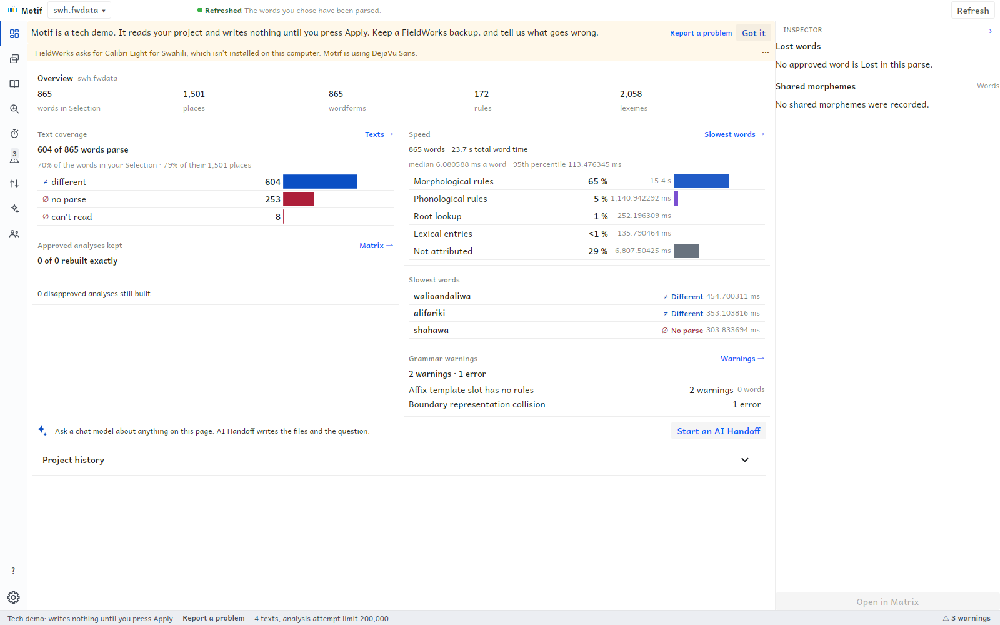
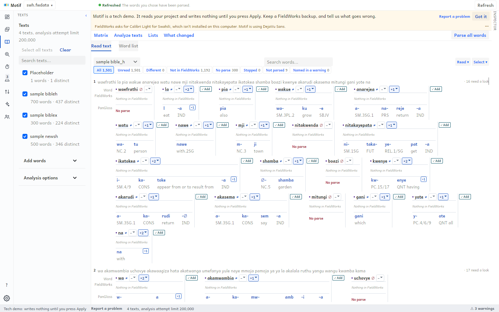
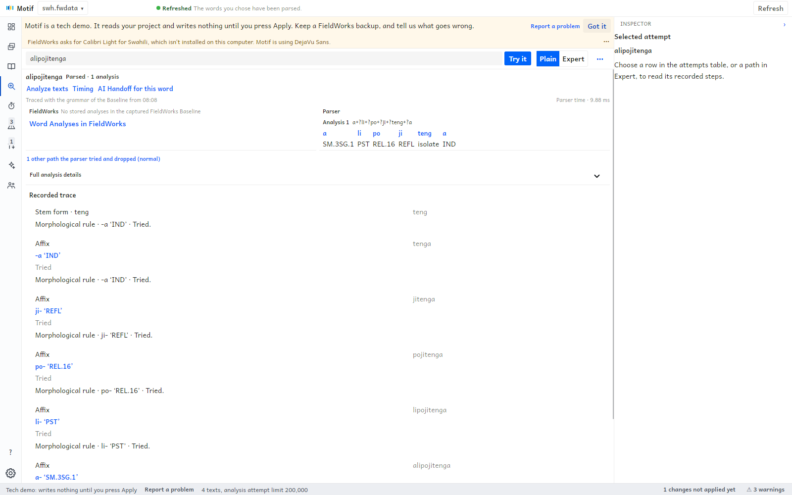
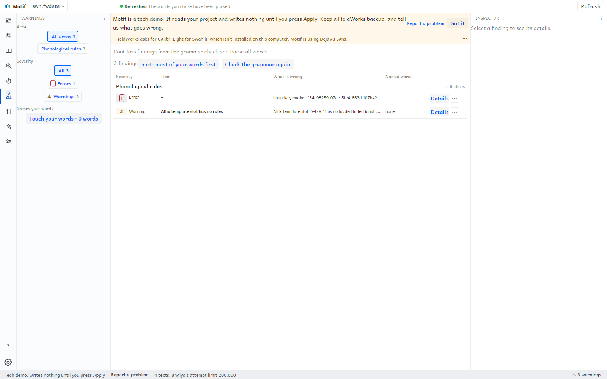
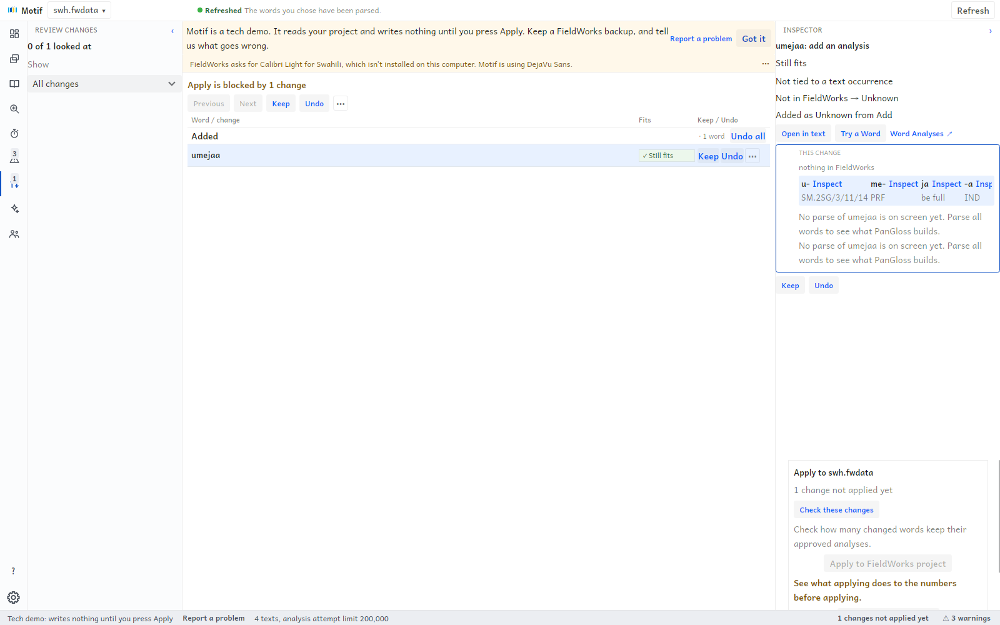

<p align="center">
  
</p>

<h1 align="center">Motif</h1>

<p align="center"><strong>See what your FieldWorks grammar does. Try a change safely. Decide for yourself.</strong></p>

<p align="center"><em>Motif is a tech demo, not a finished product. Keep a FieldWorks backup and try it on a copy of your project.</em></p>

Motif is a desktop window and a command line for linguists who build grammars in FieldWorks. A grammar that works for a few dozen words gets harder to check and improve as it grows. Motif shows you what the parser does with your own texts, lets you try a change without touching your project, and hands the result to you to decide.

## What it helps with

When you build a FieldWorks grammar, three questions come back again and again.

- **Which of my words parse, and which don't?** Motif parses the texts you choose and shows the results word by word, with Text Coverage, how many of your approved analyses the grammar still builds, how long each word takes, and what the grammar check found.
- **Why did this word fail?** Try a Word shows the parser's reasoning for one word, step by step, including where it gave up.
- **If I change the grammar, will it help or hurt?** A Proposal is a set of changes. A Trial applies it to a throwaway copy of your project and parses again, so the new numbers sit beside today's. Your FieldWorks project is not touched.

Motif reads your saved FieldWorks project and writes nothing to it until you open **Review changes**, look over each change, and choose **Apply to FieldWorks project**.

## How it works

**PanGloss measures, Motif shows, an AI assistant drafts, and a person decides.**

1. **Measure.** PanGloss, the parser, parses the words you select. Motif keeps the results of each run.
2. **Show.** The Overview, Texts, Timing and Warnings pages put those results where you can read them.
3. **Draft.** Motif can hand the whole picture to an AI assistant, as a folder of files to drag into a chat or through a connected assistant. The assistant can propose changes. It cannot apply them.
4. **Decide.** You review each change, **Keep** or **Undo** it, and apply the ones you want.

## See it



*Overview: of the 865 words in the Selection, 604 parse, 253 do not parse and 8 cannot be read. Speed and the grammar warnings sit beside the coverage, and the slowest words are listed.*



*Analyze texts: a Text read in place, each word with what FieldWorks has and what PanGloss builds, and Add where PanGloss proposes an analysis.*



*Try a Word: one Swahili word, the analysis the parser built and the steps it recorded on the way.*



*Warnings: the problems the grammar check found, to fix in FieldWorks.*



*Review changes: each change has Keep and Undo, and Apply to FieldWorks project stays off until you have looked at them.*

These images come from a real Swahili grammar project, parsed by PanGloss with no analyses approved by a person. The window shows a frame with a page rail on the left, a side panel, the Inspector on the right and a status bar. The one change in Review changes was staged in a scratch copy for the picture.

## Who it is for

Linguists and language teams who keep their grammar in FieldWorks (FLEx) and want a clearer view of how it behaves on their own texts. You do not need to write code.

## What it is not yet

- It is a **tech demo**. The window and the commands will change, and opening an older project store carries its authored data forward while computed results are regenerated.
- It does not replace FieldWorks. You still edit the grammar there. Motif applies only the changes you have reviewed.
- Installers are for invited testers. There is no automatic update, and the Windows beta may be unsigned.

## Try it

Download the Windows x64 **Setup.exe** from the [Releases page](https://github.com/sillsdev/motif/releases), choosing the beta named in your invitation, then follow the [install guide](src/SIL.Motif.Help/Content/en/guide/install.md). The Windows release includes the matching PanGloss parser. The same release offers a Linux x64 AppImage and a macOS Apple silicon ZIP as previews.

Then [open your project](src/SIL.Motif.Help/Content/en/guide/open-a-project.md), press **Refresh**, and follow [What Motif does](src/SIL.Motif.Help/Content/en/guide/what-is-motif.md). The first setup for a project starts with an analysis-attempt limit of 200,000 per word; a project's saved limit stays in effect.

## Build from source

Install the .NET 10 SDK, then from the repository root:

```powershell
./build.ps1    # comment and design-token checks, then compile
./test.ps1     # the above, then Unit and Integration tests; add -All for every level
```

Use these rather than `dotnet build` or `dotnet test`: they run the checks a bare build skips. [AGENTS.md](AGENTS.md) is the guide for contributors. It covers the test levels, the build layout, staging SIL ICU on Linux and macOS (`bash tools/stage-sil-icu.sh`), building against a local libpalaso, and the comment and design-token rules. [CONTEXT.md](CONTEXT.md) is the glossary, and its terms are binding. All Motif projects target `net10.0`.

The machine usage log keeps the newest 10,000 entries. Set `MOTIF_USAGE_MAX_ROWS` to a positive integer
to choose another limit; the limit is enforced when an entry is recorded. SQLite can reuse freed pages,
but deleting entries does not immediately shrink an existing database file.

The newest three Trial copies per project are retained for inspection and tracing; older copies and copies of
applied or discarded Proposals are removed. `MOTIF_TRIAL_SCRATCH_MAX_COUNT` sets another positive count.
At runner startup, orphan copies older than 24 hours are removed; set `MOTIF_TRIAL_SCRATCH_MAX_AGE_HOURS`
to a positive integer up to 87,600 to change that age. Active Trials are protected. Set
`MOTIF_RETAIN_TRIAL_SCRATCH=1` in the runner's environment to keep all Trial copies.

Pruning removes this project's unreferenced invocation directories when their Assessments are removed or the
directories are older than 30 days. `MOTIF_STATS_CACHE_MAX_AGE_DAYS` changes the age (positive integer, at most
3,650). Directories whose ownership cannot be proven are kept, and prune reports their count, total size and parent path. Project grammar checks keep the two most recent Baselines; `MOTIF_GRAMMAR_BASELINE_MAX_ROWS`
sets another positive limit. Trial grammar checks keep the newest five rows per Proposal;
`MOTIF_GRAMMAR_CHECK_MAX_ROWS` sets another positive limit. Responses are compressed.

The optional `MOTIF_TRACE=1` JSONL trace rotates at 10 MiB, keeping the current file and one previous file
with a `.1` suffix. `MOTIF_TRACE_MAX_BYTES` selects another positive limit for each file; an individual line larger
than the limit is dropped. `MOTIF_TRACE_FILE` selects the path; otherwise the trace uses a per-user file in the
temporary folder. Multiple processes coordinate writes to the same path.

After building, run the command or the window from `bin/<Configuration>`:

```powershell
./bin/Debug/motif.exe help                 # Windows; on Linux or macOS ./bin/Debug/motif help
./bin/Debug/SIL.Motif.App.exe              # Windows; on Linux or macOS ./bin/Debug/SIL.Motif.App
```

Motif parses with PanGloss, pinned by version and SHA-256 in [`pangloss-release.json`](pangloss-release.json). `build.ps1` stages the pinned parser beside the build. To use a parser of your own, set `MOTIF_PANGLOSS_EXE` to its path; that override is authoritative. Evaluation sets live in the separate [`motif-test-grammars`](https://github.com/sillsdev/motif-test-grammars) repository: fetch the locked revision with `pwsh ./evals/Get-TestGrammars.ps1`, or tests that need them skip with a reason.

To stage a release payload, install the pinned Velopack CLI (`dotnet tool install --global vpk --version 1.2.158`) and run `./tools/package-release.ps1`. The [package workflow](.github/workflows/package.yml) builds the Windows Setup, Linux AppImage and macOS ZIP; see the install guide for what each preview does and does not promise.

## Documentation

The `motif` command, the window and the documentation site share one set of authored Help in [`src/SIL.Motif.Help/Content/`](src/SIL.Motif.Help/Content/). The site in [`site/`](site/) is built from it: export the catalog with `motif help --all --json > bin/help-export.json`, then in `site/` run `npm ci`, `npm test` and `npm run build` with Node 22.12 or later, with `MOTIF_HELP_EXPORT` pointing at the export. `./tools/Build-Media.ps1` rebuilds the generated media. In CI, the **CI** workflow's `publish_website` option builds and validates the site artifact; it does not deploy it.

Read next:

- [Current architecture](docs/current-architecture.md): project references, command sharing and cache ownership.
- [CLI and command API](docs/cli-api.md): where command usage and Guides are kept.
- [Building a grammar: a suggested order](src/SIL.Motif.Help/Content/en/guide/building-a-grammar.md): the order linguists usually work in, with the reasons; advice, not a rule.
- [Semantic change contract](docs/change-set-contract.md) and [Proposal lifecycle](docs/proposal-lifecycle.md).
- [Assessment model](docs/adr/0042-a-job-produces-assessments-an-assessor-makes-them.md) and [parser handoff](docs/pangloss-grammar-assessment-handoff-spec.md).
- [Motif in Brief](docs/pitch/dist/Motif-in-Brief.pdf), a short illustrated pitch.
- Older plans, kept as history: [Plan A](docs/plan-motif.md), [product architecture plan](docs/plan-product-architecture.md), [architecture proposal](docs/architecture.md).

## Licence

Motif software is MIT-licensed. That license does not authorize grammar or FieldWorks project payloads in this repository: [ADR 0076](docs/adr/0076-grammar-data-never-belongs-in-motif.md) prohibits committing real, synthetic, self-authored, self-generated or agent-generated data. Tracked legacy payloads remain violations pending separate removal; they are not exceptions. Pinned external evaluation data has its own terms in the [external evaluation-data licence notice](https://github.com/sillsdev/motif-test-grammars/blob/v0.3.0/evals/DATA-LICENSES.md).
