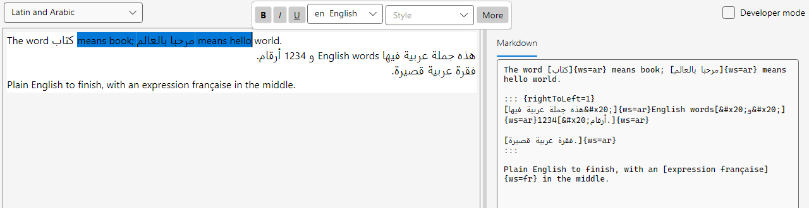
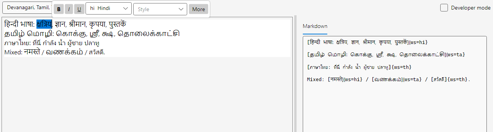
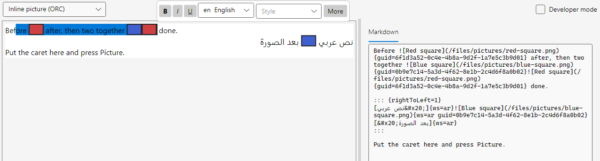
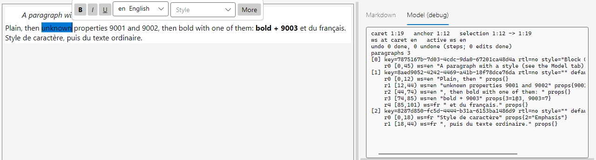
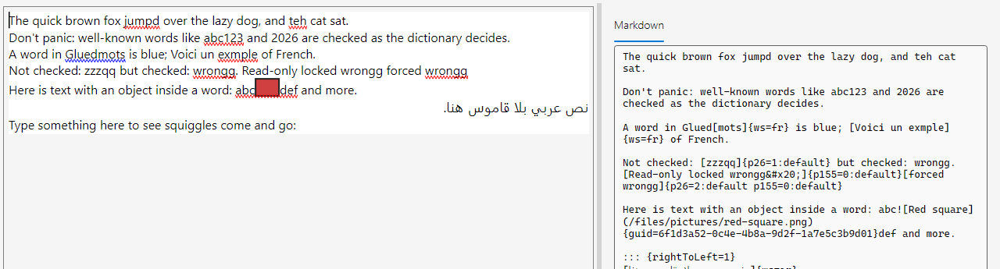
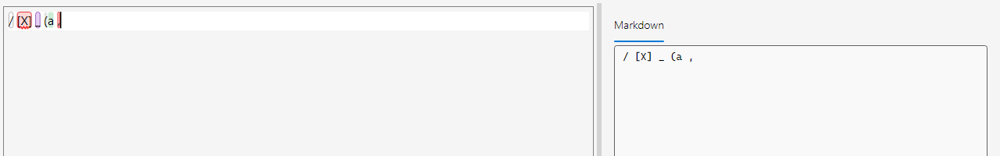
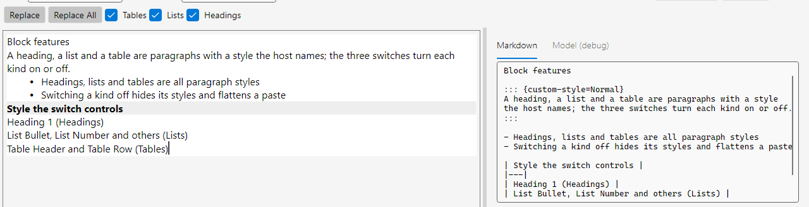
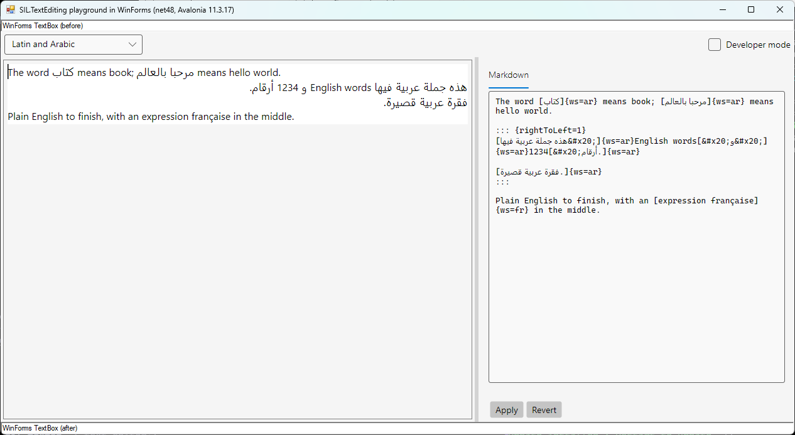
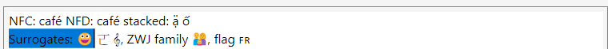
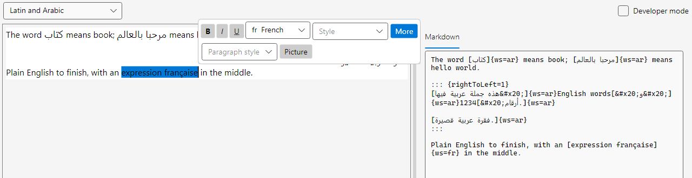

# SIL.TextEditing

**Rich text editing for Avalonia in which every run of text knows its writing system.**

SIL.TextEditing is being built as the rich text field for [FieldWorks](https://software.sil.org/fieldworks/) and Motif, and for any
[Avalonia](https://avaloniaui.net/) app that edits multilingual text. Each run carries its own writing system, so Latin, Arabic and
Devanagari share one paragraph and each keeps its own font, spelling dictionary and keyboard. The run model is shaped like FieldWorks'
`ITsString`, and an adapter maps it to and from liblcm. One source tree builds against Avalonia 11.3 for FieldWorks (.NET Framework 4.8,
inside WinForms) and Avalonia 12 for Motif (.NET 10). Text can be written as FieldWorks Markdown, a strict profile of Pandoc Markdown that
Pandoc reads the same way the library does. The host owns the data and the undo stack; the field edits what it is given.

**Status: unreleased. The API will change.** Everything outside the [Roadmap](#roadmap) is built and tested today.



| | |
|---|---|
|  |  |
| [Hindi, Tamil and Thai, shaped, with a conjunct selected as one cluster](docs/images/README.md) | [Inline pictures in left-to-right and right-to-left text](docs/images/README.md) |
|  |  |
| [Properties the editor does not know survive every edit](docs/images/README.md) | [Spelling per writing system; blue where a word mixes two](docs/images/README.md) |
|  |  |
| [A notation box with a language service: chips and diagnostics](docs/images/README.md) | [Tables, lists and headings, switched on or off per field](docs/images/README.md) |
|  |  |
| [Inside WinForms on .NET Framework 4.8: FieldWorks' shape](docs/images/README.md) | [NFD, stacked marks and surrogate pairs](docs/images/README.md) |

## What people and agents edit

The first paragraph of the picture above, as FieldWorks Markdown, the form a person or an AI agent reads and edits:

```markdown
The word [كتاب]{ws=ar} means book; [مرحبا بالعالم]{ws=ar} means hello world.
```

Unmarked text is the analysis writing system (English here); `[...]{ws=ar}` is another writing system and `[...]{.v}` the vernacular. A new
run starts wherever the writing system or a property changes, so nothing numbers runs or records offsets. The two right-to-left
paragraphs of the picture share one `::: {rightToLeft=1}` block. A file adds a short front matter, generated by the writer, that names the
writing systems ([the format](docs/formats/fieldworks-markdown.md)).

The same text has four forms, and only the first two are meant to be edited by hand:

| Form | What it is for | Edited by hand |
|---|---|---|
| **FieldWorks Markdown** (`*.fw.md`) | People, AI agents, files and diffs; Pandoc reads it the same way | Yes |
| **Record file** | A whole FieldWorks record: a YAML frame whose rich values are FieldWorks Markdown ([record files](docs/formats/record-files.md)) | Yes |
| **`Document`, `Paragraph`, `Run`** | The editor's model in memory: per run the text, writing system and property bag; per paragraph the host's key | No: the playground's developer mode dumps it in its "Model (debug)" tab |
| **liblcm `ITsString`** | FieldWorks' storage; the LCModel adapter maps it to and from the run model | No |

**An agent's edit** is a text edit. Change the gloss and mark a vernacular word:

```diff
-The word [كتاب]{ws=ar} means book; [مرحبا بالعالم]{ws=ar} means hello world.
+The word [كتاب]{ws=ar} means [kitabu]{.v}; [مرحبا بالعالم]{ws=ar} means hello world.
```

The reader checks it: a malformed span or an unknown writing system is a finding with a line, a column and, where one exists, the exact
fix ([findings](docs/formats/findings.md)), and nothing is applied while there is an error. The host applies the rest as one undo step. In
the playground, edit the Markdown beside the field and press Apply; `MarkdownTabTests` makes this very edit.

## Why it's different

- **A writing system on every run.** A `Run` holds text, a writing-system id, a property bag keyed by FieldWorks property numbers, and
  object data, as an `ITsString` run does. The editor carries properties it does not understand through every edit. The LCModel adapter
  round-trips real liblcm strings (ADR 0016, 111 tests per target).
- **Both Avalonia lines from one source tree.** Avalonia 11.3.17 on net48 inside WinForms, and Avalonia 12.1.2 on net10.0, with a few small
  per-version differences, [listed](docs/reference/avalonia-versions.md#per-version-differences) ([ADR 0009](docs/adr/0009-two-avalonia-lines.md)). The surface tests run on both: 777 on
  net48, 778 on net10.0.
- **FieldWorks editing behaviour.** Arrow keys are logical by paragraph direction, text is stored as NFD, Backspace and Delete work as
  in FieldWorks ([ADR 0018](docs/adr/0018-fieldworks-editing-semantics.md)). Complex shaping and inline objects. Screen readers get FieldWorks' MSAA level (name, role, value)
  through Avalonia's peers; in WinForms the host needs a small fix first ([ADR 0017](docs/adr/0017-screen-reader-gate.md)).
- **FieldWorks Markdown that Pandoc agrees with.** Read lenient, write strict. 664 tests run Pandoc 3.9.0.2 itself: 334 fixture
  cases (every one without an error finding, bar a few excluded with a stated reason), 200 generated documents and record files and the 5
  link forms must read to the same structure; 124 more check that what Pandoc reads as another construct is reported; one pins the version
  ([ADR 0028](docs/adr/0028-fieldworks-markdown-is-a-pandoc-profile.md)).
- **Records as files.** A whole record as one file: a YAML frame typed by a schema that is data, FieldWorks Markdown in the rich values,
  and a JSON Schema for editors ([ADR 0032](docs/adr/0032-record-files-yaml-frame.md)).
- **The host stays in charge.** The host owns data and undo ([ADR 0003](docs/adr/0003-host-owns-data-and-undo.md)), and supplies the
  dictionaries, keyboards, clipboard forms, language services and the blocks a field allows.
- **Ready for native AOT.** `SIL.TextEditing`, `SIL.TextEditing.Avalonia` and `SIL.TextEditing.Markdown` are trimmable and AOT-compatible on
  net10.0 (the LCModel adapter is not). CI's `tests/AotCheck` publishes all three native AOT, rooted whole so any trim or AOT warning
  fails, and runs the Markdown converter, record files and the libpalaso writing-system path in the published exe.

The whole suite passes with 0 failures on net48 and net10.0. Passing tests per target, Release, main 7e77466 (2026-11-06), Pandoc on PATH.
Opt-in tests that skip by default are not counted: 11 screenshot generators (`TEXTEDITING_SCREENSHOTS`) and 3 real-clipboard tests
(`TEXTEDITING_REAL_CLIPBOARD`).

| Tests | Model | Avalonia | Markdown | LCModel | Playground | SecondDispatcher |
|---|---|---|---|---|---|---|
| net48 | 416 | 777 | 3843 | 111 | 304 | — |
| net10.0 | 416 | 778 | 3843 | 111 | 304 | 3 |

## Quick start

Windows, the .NET 10 SDK and the .NET Framework 4.8 targeting pack:

```
dotnet build SIL.TextEditing.sln
dotnet test  SIL.TextEditing.sln
```

Try it:

```
run desktop10     # Avalonia desktop window on .NET 10, Avalonia 12
run desktop48     # the same window on .NET Framework 4.8, Avalonia 11.3.17
run winforms48    # WinForms form: TextBox, playground, TextBox (FieldWorks' shape)
run desktop10 --scenario "Inline picture (ORC)"
```

`run.cmd` and `run.ps1` build the host and start it. The playground shows what a person writing sees: a scenario picker, the field, and
beside it the field as FieldWorks Markdown, which you can edit and apply. Select some text and a small bar appears over it: bold, italic,
underline, writing system and character style, and under **More** the paragraph style and a picture. **Developer mode** (the check box, or
`--dev`) adds every switch, the model's runs and the event log. The scenarios: bidi, Indic and Thai shaping, NFD, inline pictures, unknown
properties, spelling, the environment box, long documents. The Pandoc tests need `pandoc` on `PATH`.



## Projects

| Project | What it is |
|---|---|
| `src/SIL.TextEditing` | The UI-free run model, editing, clipboard forms and paste rules. No Avalonia, no liblcm. |
| `src/SIL.TextEditing.Avalonia` | `RichTextField`, the control. |
| `src/SIL.TextEditing.Markdown` | FieldWorks Markdown and record files. Trimmable and AOT-compatible. |
| `src/SIL.TextEditing.LCModel` | The `ITsString` adapter and the TsString XML clipboard form. |
| `samples/SIL.TextEditing.Playground` | The shared playground UI both hosts and the integration tests use. |
| `samples/Playground.Desktop` | The playground in a plain Avalonia window, net48 and net10.0. |
| `samples/Host48` | The playground inside a WinForms form, net48: FieldWorks' shape. |
| `tests/*` | Model, surface, Markdown, LCModel, playground, second-dispatcher, real-clipboard and AOT tests. |

Libraries target netstandard2.0 and net10.0. Details: [Projects and tests](docs/reference/projects.md).

## Documentation

- [Reference](docs/reference/README.md): the run model, editing, clipboard, spelling, the language service, rendering, the two Avalonia
  versions, the LCModel adapter, the Markdown library, known limitations.
- [Formats](docs/formats/README.md): FieldWorks Markdown, record files, the clipboard forms, tables, and every finding id.
- [Decisions](docs/adr): the architecture decision records.
- [Feature inventory](docs/feature-inventory.md): FieldWorks' editing features and where each stands here.
- [Manual testing](docs/manual-testing.md): the checklist a person runs.
- [Glossary](GLOSSARY.md): the words this project uses.
- [Screenshots](docs/images/README.md): every image, and how to regenerate it.

## Roadmap

Planned, not built:

- **Word-compatible copy and paste.** HTML and RTF out, HTML in, in a new `SIL.TextEditing.WordInterchange` project
  ([ADR 0031](docs/adr/0031-shared-editing-and-interchange-layer.md),
  [clipboard plan](docs/formats/clipboard.md#planned-word-html-and-rtf)).
- **Real tables** in the field ([#152](https://github.com/sillsdev/SIL.TextEditing/issues/152), [tables plan](docs/formats/tables.md#planned-real-tables-in-the-field)).
- **`SIL.TextEditing.Project`**: LCModel-backed record I/O and the record schema built from liblcm metadata
  ([ADR 0031](docs/adr/0031-shared-editing-and-interchange-layer.md), [ADR 0033](docs/adr/0033-block-features.md)).
- **The `fwmd` command-line checker** ([#161](https://github.com/sillsdev/SIL.TextEditing/issues/161)).
- **The FieldWorks Markdown clipboard form** ([#168](https://github.com/sillsdev/SIL.TextEditing/issues/168)).
- **Editor integration**: an inline WYSIWYG and Markdown source mode, and a VS Code extension with a language server. The playground's
  Markdown pane is a host-side sketch of the source mode. The plan and a proposed ADR are awaiting owner decisions ([#170](https://github.com/sillsdev/SIL.TextEditing/issues/170)).
- **Retiring the liblcm refusals** once FieldWorks pins a liblcm with its fixes [#410](https://github.com/sillsdev/liblcm/issues/410), [#413](https://github.com/sillsdev/liblcm/issues/413) and [#414](https://github.com/sillsdev/liblcm/issues/414) ([#159](https://github.com/sillsdev/SIL.TextEditing/issues/159)).

## Contributing

Read [AGENTS.md](AGENTS.md) first: the rules for layering, packages, tests and commits apply to people and agents alike. Known limitations
are in [docs/reference/limitations.md](docs/reference/limitations.md).

## Licence

MIT, copyright SIL Global. See [LICENSE](LICENSE). FieldWorks code is LGPL and is not copied here: FieldWorks behaviour is re-implemented
from documentation, standards, tests and observed behaviour ([ADR 0010](docs/adr/0010-mit-clean-room.md)).
